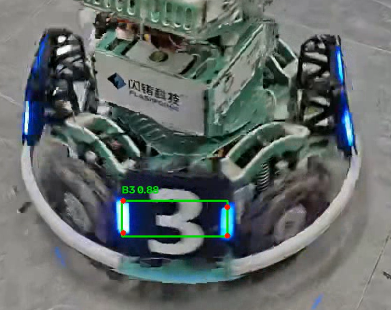
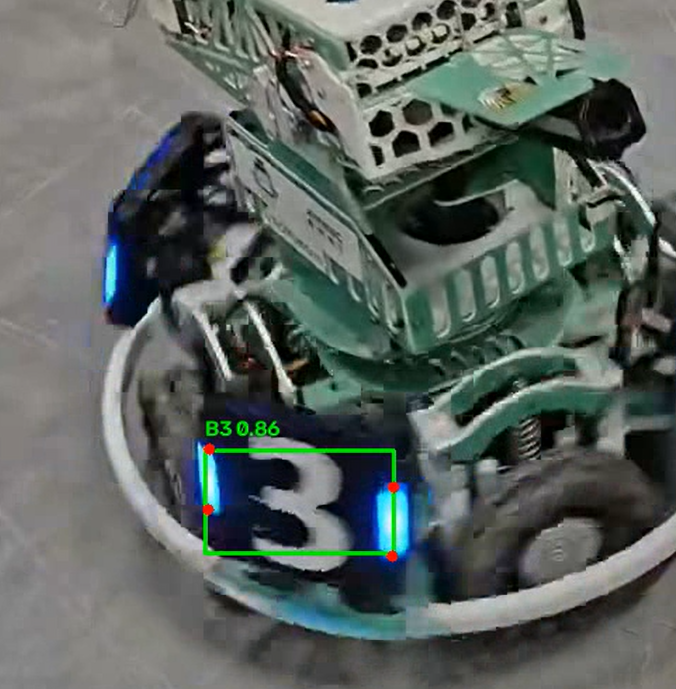

# Ciallo-yolo

YOLO装甲板视频推理作业

1. 项目完成的功能：读取视频中可能出现的装甲板，将装甲板的轮廓用绿线包裹，并在左上角依次标明颜色、数字序号和置信度，并标注出左右两个荧光条的四个点。
2. Python版本、主要依赖，以及使用CPU还是GPU：我的python版本为3.14，主要依赖为大于等于8.0版本的ultralytics库，opencv的python包，numpy库和torch库。询问CUDA是否可用： False，证明使用的是CPU。
3. 模型权重的准备方式与放置位置：准备方式为全部调用的.pt文件中的内容，放置位置在仓库名称文件夹下。
4. 依赖安装步骤、实际运行命令和结果保存位置：

   1).新建Python虚拟环境（避免库版本冲突），在git bash里输入：

   python -m venv venv

   然后输入

   venv\Scripts\activate

   让Windows激活虚拟环境，最后使用

   pip install -r requirements.txt

   即可一键调用requirements文件来下载依赖。

   2).默认运行输入

   python infer.py

   或者自定义参数运行

   python infer.py --model best.pt --video test.mp4 --output result.mp4

   可以分别修改YOLO 模型权重文件路径、待推理的原始输入视频和推理结果视频保存路径。

   3).推理完成后，带有检测框、类别文字、关键点红点的视频，会保存到--output参数指定的路径；
   不指定参数时，默认输出到项目根目录，文件名为result.mp4，与 infer.py 在同一个文件夹。
5. 视频拍摄地点、时长及场景说明：地点水利与建筑学院D414实验室，时长约11秒，场景为操控状态下不断摇动装甲板的小车。
6. 能展示检测框和关键点的代表性结果截图：如下，仅选取具有代表性的几张图片链接：

7.实际识别表现、遇到的问题及处理方法:

1).实际识别表现尚可，几乎所有完整出现的装甲板可以精确标注，偶尔有只露出一边荧光条的装甲板会被预判标记

2).处理方法：我并不会处理（），可能再需要多一些数据和处理把。
